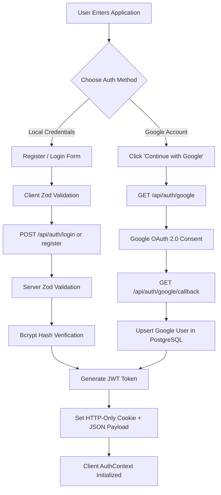

# Full-Stack Post Management System — Technical Documentation

## Executive Summary

The **Full-Stack Post Management System** is an enterprise-grade web application engineered to demonstrate modern full-stack web development principles. It couples an external public REST API ([JSONPlaceholder](https://jsonplaceholder.typicode.com/)) with a custom **Node.js/Express.js** backend, a **PostgreSQL** relational database managed via **Prisma ORM**, and a client-side **React 19 Single Page Application (SPA)** built with **Vite**, **TypeScript**, and **Tailwind CSS**.

This document provides a comprehensive technical breakdown of every technology, design pattern, security control, and architectural component implemented across the codebase.

---

## Table of Contents

1. [High-Level Architecture & System Design](#1-high-level-architecture--system-design)
2. [Comprehensive Technology Breakdown](#2-comprehensive-technology-breakdown)
   - [2.1 Frontend Technologies](#21-frontend-technologies)
   - [2.2 Backend Technologies](#22-backend-technologies)
   - [2.3 Database & ORM](#23-database--orm)
   - [2.4 External REST API](#24-external-rest-api)
   - [2.5 Testing & Tooling](#25-testing--tooling)
3. [Authentication & Authorization Pipeline](#3-authentication--authorization-pipeline)
   - [3.1 Dual Authentication Strategy](#31-dual-authentication-strategy)
   - [3.2 Password Hashing with Bcrypt](#32-password-hashing-with-bcrypt)
   - [3.3 Google OAuth 2.0 / OpenID Connect Flow](#33-google-oauth-20--openid-connect-flow)
   - [3.4 JWT & Secure Cookie Session Handling](#34-jwt--secure-cookie-session-handling)
   - [3.5 Role-Based Access Control (RBAC) Architecture](#35-role-based-access-control-rbac-architecture)
4. [Data Architecture & JSONPlaceholder Integration Pattern](#4-data-architecture--jsonplaceholder-integration-pattern)
   - [4.1 The Simulated Persistence Challenge](#41-the-simulated-persistence-challenge)
   - [4.2 The Ownership Resolution Pattern](#42-the-ownership-resolution-pattern)
   - [4.3 Prisma Data Models](#43-prisma-data-models)
5. [Frontend Engineering & UI/UX Design System](#5-frontend-engineering--uiux-design-system)
   - [5.1 State Management (Context API)](#51-state-management-context-api)
   - [5.2 Centralized Axios Client & Interceptors](#52-centralized-axios-client--interceptors)
   - [5.3 Protected Routes & Client-Side RBAC Guarding](#53-protected-routes--client-side-rbac-guarding)
   - [5.4 Modern Glassmorphism Design System](#54-modern-glassmorphism-design-system)
6. [Security & Defensive Engineering](#6-security--defensive-engineering)
   - [6.1 Helmet Security Headers](#61-helmet-security-headers)
   - [6.2 Cross-Origin Resource Sharing (CORS)](#62-cross-origin-resource-sharing-cors)
   - [6.3 Brute-Force & Rate Limiting](#63-brute-force--rate-limiting)
   - [6.4 Request Validation via Zod](#64-request-validation-via-zod)
   - [6.5 Error Handling & Information Leak Prevention](#65-error-handling--information-leak-prevention)
7. [API Specification & OpenAPI Documentation](#7-api-specification--openapi-documentation)
8. [Testing & Quality Assurance](#8-testing--quality-assurance)
9. [Deployment & DevOps Blueprint](#9-deployment--devops-blueprint)

---

## 1. High-Level Architecture & System Design

The application follows a **Decoupled 3-Tier Architecture** featuring an **Intermediary API Gateway Pattern**:

```text
[ Browser / Client ]
        │
        │ HTTP/HTTPS (REST + JSON + Credentials)
        ▼
[ Express.js Backend API Layer ] ─── (Port 5000)
   ├── Security Middleware (Helmet, CORS, RateLimit, CookieParser)
   ├── Auth Middleware (authenticateUser, optionalAuth)
   ├── RBAC Middleware (requireRole: USER vs ADMIN)
   ├── Controllers & Services (Business Logic)
   └── Interactive Documentation (Swagger UI at /api-docs)
        │                               │
        │ Prisma ORM (Binary Engine)    │ Axios HTTP Client
        ▼                               ▼
[ PostgreSQL Database ]        [ JSONPlaceholder REST API ]
   ├── users                   (https://jsonplaceholder.typicode.com)
   └── post_ownerships                 └── /posts (Mock Data)
```

### Architectural Principles:
1. **Zero Direct Client-to-Third-Party Coupling**: The React frontend communicates strictly with `/api/*`. It never calls `jsonplaceholder.typicode.com` directly. The backend orchestrates external REST calls, adds authentication tokens, sanitizes payloads, and merges ownership metadata.
2. **Stateless Scalability**: Authentication uses signed JSON Web Tokens (JWT) stored in HTTP-only cookies, allowing horizontal backend scaling without server session affinity locks.
3. **Defense-in-Depth**: Hiding UI buttons based on user roles is strictly a user experience enhancement. All authorizations are independently evaluated and enforced on the server.

---

## 2. Comprehensive Technology Breakdown

### 2.1 Frontend Technologies

#### 1. React 19 (`react`, `react-dom`)
- **What it is**: The industry-standard declarative library for building component-driven user interfaces.
- **Why it was selected**: React 19 provides superior rendering performance, concurrent features, and streamlined hooks.
- **Where it is used**: Powers the entire client directory (`client/src/`).
- **Key implementation**: Functional components with hooks (`useState`, `useEffect`, `useMemo`, `useCallback`, `useContext`).

#### 2. TypeScript (`typescript`)
- **What it is**: A strongly typed superset of JavaScript that compiles to plain JavaScript.
- **Why it was selected**: Guarantees type safety across frontend and backend boundaries, eliminates `undefined` runtime crashes, and provides autocomplete for data models (`User`, `Post`, `ApiResponse`, `Role`).
- **Where it is used**: All source files across `client/src/**/*.tsx` and `server/src/**/*.ts`.

#### 3. Vite 6 (`vite`)
- **What it is**: Next-generation frontend build tool and development server powered by Rollup and esbuild.
- **Why it was selected**: Instant server start with native ES Modules (ESM), sub-millisecond Hot Module Replacement (HMR), and optimized tree-shaken production bundles.
- **Where it is used**: [client/vite.config.ts](file:///d:/Niranjana/fullstack/client/vite.config.ts) and build scripts in `client/package.json`. Configured with a local development proxy pointing `/api` to `http://localhost:5000`.

#### 4. React Router v7 (`react-router-dom`)
- **What it is**: Standard declarative client-side routing library for React applications.
- **Why it was selected**: Enables seamless SPA navigation without full browser refreshes, nested layout routing, dynamic route parameters (`/posts/:id`), and programmatic redirection.
- **Where it is used**: [client/src/App.tsx](file:///d:/Niranjana/fullstack/client/src/App.tsx) and [client/src/components/ProtectedRoute.tsx](file:///d:/Niranjana/fullstack/client/src/components/ProtectedRoute.tsx).

#### 5. Tailwind CSS v4 & `@tailwindcss/vite`
- **What it is**: A modern utility-first CSS framework integrated via Vite's dedicated compiler plugin.
- **Why it was selected**: Eliminates the overhead of managing large bespoke CSS stylesheets, enforces consistent spacing and typography scales, and delivers minimal CSS bundle sizes via compile-time purging.
- **Where it is used**: Configured in [client/src/index.css](file:///d:/Niranjana/fullstack/client/src/index.css) using the `@import "tailwindcss";` directive and applied across all JSX templates.

#### 6. Axios (`axios`)
- **What it is**: Promise-based HTTP client for the browser and Node.js.
- **Why it was selected**: Supports request/response interceptors, automatic JSON serialization/deserialization, and cookie credential transport (`withCredentials: true`).
- **Where it is used**: [client/src/services/api.ts](file:///d:/Niranjana/fullstack/client/src/services/api.ts) for client-to-backend communication, and [server/src/services/jsonPlaceholderService.ts](file:///d:/Niranjana/fullstack/server/src/services/jsonPlaceholderService.ts) for backend-to-JSONPlaceholder calls.

#### 7. React Icons (`react-icons`)
- **What it is**: Icon library providing vector SVG icons from popular icon sets.
- **Why it was selected**: Provides clean icons (Feather Icons `Fi*` and Flat Color Icons `FcGoogle`) with zero runtime styling conflicts.
- **Where it is used**: Buttons, badges, modals, and navigation across all client pages.

---

### 2.2 Backend Technologies

#### 1. Node.js
- **What it is**: Asynchronous event-driven JavaScript runtime built on Chrome's V8 engine.
- **Why it was selected**: High concurrency, non-blocking I/O ideal for API gateways handling multiple outbound REST and database calls.

#### 2. Express.js 4 (`express`)
- **What it is**: Fast, unopinionated, minimalist web framework for Node.js.
- **Why it was selected**: Robust middleware ecosystem, clean routing abstractions, and standard industry adoption for enterprise REST APIs.
- **Where it is used**: [server/src/app.ts](file:///d:/Niranjana/fullstack/server/src/app.ts), mounting modular sub-routers (`authRoutes`, `postRoutes`, `userRoutes`).

#### 3. Passport.js & Google OAuth 2.0 Strategy (`passport`, `passport-google-oauth20`)
- **What it is**: Comprehensive authentication middleware for Node.js.
- **Why it was selected**: Provides a proven OpenID Connect / OAuth 2.0 flow with Google, handling profile extraction, token exchanges, and error callbacks.
- **Where it is used**: [server/src/config/passport.ts](file:///d:/Niranjana/fullstack/server/src/config/passport.ts) and [server/src/controllers/authController.ts](file:///d:/Niranjana/fullstack/server/src/controllers/authController.ts).

#### 4. JSON Web Tokens (`jsonwebtoken`)
- **What it is**: Open standard (RFC 7519) compact URL-safe means of representing claims between two parties.
- **Why it was selected**: Allows stateless authentication; the token payload contains `userId`, `email`, and `role`, signed with an HMAC-SHA256 secret.
- **Where it is used**: Generated in [server/src/services/authService.ts](file:///d:/Niranjana/fullstack/server/src/services/authService.ts) and decoded in [server/src/middleware/auth.ts](file:///d:/Niranjana/fullstack/server/src/middleware/auth.ts).

#### 5. Bcrypt (`bcryptjs`)
- **What it is**: Optimized password-hashing function based on the Blowfish cipher incorporating salting and adaptive work factors.
- **Why it was selected**: Resistant to brute-force and rainbow table attacks. Configured with **12 salt rounds** to strike an optimal balance between security and CPU hashing time.
- **Where it is used**: [server/src/services/authService.ts](file:///d:/Niranjana/fullstack/server/src/services/authService.ts) during user registration and password verification.

#### 6. Zod (`zod`)
- **What it is**: TypeScript-first schema declaration and validation library with static type inference.
- **Why it was selected**: Validates incoming request bodies at runtime before reaching controllers, ensuring bad input never touches database layers.
- **Where it is used**: [server/src/validators/index.ts](file:///d:/Niranjana/fullstack/server/src/validators/index.ts) and [server/src/middleware/validate.ts](file:///d:/Niranjana/fullstack/server/src/middleware/validate.ts).

#### 7. Helmet (`helmet`)
- **What it is**: Security middleware that sets secure HTTP response headers.
- **Why it was selected**: Mitigates Cross-Site Scripting (XSS), clickjacking, MIME-sniffing, and cross-site injection attacks by setting `X-Frame-Options`, `Content-Security-Policy`, and `Strict-Transport-Security`.
- **Where it is used**: Initialized on the root Express instance in [server/src/app.ts](file:///d:/Niranjana/fullstack/server/src/app.ts).

#### 8. Express Rate Limit (`express-rate-limit`)
- **What it is**: Basic rate-limiting middleware for Express.
- **Why it was selected**: Guards against denial-of-service (DoS) and credential stuffing attacks. Auth endpoints are capped at 20 requests per 15 minutes; general endpoints are capped at 200 requests.
- **Where it is used**: [server/src/app.ts](file:///d:/Niranjana/fullstack/server/src/app.ts).

#### 9. Cookie Parser (`cookie-parser`)
- **What it is**: Middleware that parses cookie headers and populates `req.cookies`.
- **Why it was selected**: Enables HTTP-only cookie session token retrieval on every request without requiring manual header parsing.
- **Where it is used**: [server/src/app.ts](file:///d:/Niranjana/fullstack/server/src/app.ts) and [server/src/middleware/auth.ts](file:///d:/Niranjana/fullstack/server/src/middleware/auth.ts).

#### 10. Morgan (`morgan`)
- **What it is**: HTTP request logger middleware for Node.js.
- **Why it was selected**: Records method, endpoint, status code, and response latency to the server logger while masking credentials.
- **Where it is used**: [server/src/app.ts](file:///d:/Niranjana/fullstack/server/src/app.ts).

---

### 2.3 Database & ORM

#### 1. PostgreSQL
- **What it is**: High-performance, open-source object-relational SQL database.
- **Why it was selected**: ACID compliance, rich constraint checking (foreign keys, unique indexes, cascading deletes), and robust production reliability across modern cloud platforms (Render, Supabase, Neon, AWS RDS).

#### 2. Prisma ORM v6 (`@prisma/client`, `prisma`)
- **What it is**: Next-generation Node.js and TypeScript ORM featuring declarative data modeling, automatic migrations, and type-safe query generation.
- **Why it was selected**: Generates a typed TypeScript client directly from [server/prisma/schema.prisma](file:///d:/Niranjana/fullstack/server/prisma/schema.prisma). Ensures compile-time detection of mismatched columns or invalid queries.
- **Where it is used**: Singleton instance in [server/src/config/database.ts](file:///d:/Niranjana/fullstack/server/src/config/database.ts), utilized across `authService`, `postService`, `userService`, and `prisma/seed.ts`.

---

### 2.4 External REST API

#### JSONPlaceholder (`https://jsonplaceholder.typicode.com`)
- **What it is**: A free, online fake REST API used for prototyping and demonstration.
- **Endpoint utilized**: `/posts` (supports simulated `GET`, `POST`, `PUT`, `PATCH`, `DELETE`).
- **Integration architecture**: Handled exclusively through [server/src/services/jsonPlaceholderService.ts](file:///d:/Niranjana/fullstack/server/src/services/jsonPlaceholderService.ts).

---

### 2.5 Testing & Tooling

#### 1. Vitest v2 (`vitest`)
- **What it is**: Blazing-fast unit and integration testing framework powered by Vite.
- **Why it was selected**: Native TypeScript support without complex Babel or ts-jest transforms, Jest-compatible API (`describe`, `it`, `expect`, `vi`), and instant test execution.
- **Where it is used**: [server/src/__tests__/](file:///d:/Niranjana/fullstack/server/src/__tests__/) testing auth, RBAC, posts, and JSONPlaceholder integrations.

#### 2. TSX (`tsx`)
- **What it is**: TypeScript Execute — a fast TypeScript runtime execution engine powered by esbuild.
- **Why it was selected**: Runs TypeScript files (`prisma/seed.ts` and `src/app.ts`) without requiring a separate compilation step during development.

---

## 3. Authentication & Authorization Pipeline

### 3.1 Dual Authentication Strategy

The application accommodates two distinct user onboarding pathways:



---

### 3.2 Password Hashing with Bcrypt

Plaintext passwords are never stored or logged. Registration invokes:
```typescript
const SALT_ROUNDS = 12;
const passwordHash = await bcrypt.hash(password, SALT_ROUNDS);
```
During login:
```typescript
const isMatch = await bcrypt.compare(password, user.passwordHash);
if (!isMatch) {
  throw new UnauthorizedError('Invalid email or password');
}
```
If an account was registered through Google and lacks a password hash (`passwordHash === null`), the system prevents credential injection:
```typescript
if (!user.passwordHash) {
  throw new UnauthorizedError(
    'This account uses Google Sign-In. Please use "Continue with Google" to log in.'
  );
}
```

---

### 3.3 Google OAuth 2.0 / OpenID Connect Flow

Configured via `passport-google-oauth20` in [server/src/config/passport.ts](file:///d:/Niranjana/fullstack/server/src/config/passport.ts):
1. **Initiation**: Calling `/api/auth/google` triggers Passport with scopes `['profile', 'email']`.
2. **Account Linking**: When Google returns the authenticated profile:
   - If a user with `googleId` exists, their profile is retrieved and avatar updated.
   - If a local user with the same email exists, the account is linked by writing `googleId` to the existing record.
   - Otherwise, a new record is created with `provider = GOOGLE` and `role = USER`.
3. **Redirect Handshake**: The callback sets the session cookie and redirects the browser to `/auth/callback?token=<JWT>`. The client reads the query parameter, seeds `localStorage`, and navigates to `/dashboard`.

---

### 3.4 JWT & Secure Cookie Session Handling

The server signs tokens containing minimal, immutable claims:
```typescript
interface JwtPayload {
  userId: string;
  email: string;
  role: Role;
}
```
Tokens are dispatched via **HTTP-only cookies**:
```typescript
res.cookie('token', token, {
  httpOnly: true,                                  // Inaccessible to malicious client scripts (XSS defense)
  secure: process.env.NODE_ENV === 'production',   // Transmitted exclusively over HTTPS in production
  sameSite: process.env.NODE_ENV === 'production' ? 'none' : 'lax', // CSRF mitigation
  maxAge: 7 * 24 * 60 * 60 * 1000,                // 7-day expiration
  path: '/',
});
```

---

### 3.5 Role-Based Access Control (RBAC) Architecture

Authentication answers **"Who are you?"**; Authorization answers **"What are you permitted to do?"**.

#### RBAC Middleware: `requireRole(...roles: Role[])`
Defined in [server/src/middleware/rbac.ts](file:///d:/Niranjana/fullstack/server/src/middleware/rbac.ts):
```typescript
export const requireRole = (...roles: Role[]) => {
  return (req: Request, _res: Response, next: NextFunction): void => {
    if (!req.user) {
      return next(new UnauthorizedError('Authentication required')); // 401
    }

    if (!roles.includes(req.user.role)) {
      return next(
        new ForbiddenError('You do not have permission to perform this action') // 403
      );
    }

    next();
  };
};
```

#### Authorization Matrix:
- **`401 Unauthorized`**: Returned when no token is present, token is expired, or signature is invalid.
- **`403 Forbidden`**: Returned when the user's identity is authenticated, but their assigned role is insufficient (e.g., standard `USER` attempting `GET /api/users` or editing another user's post).

---

## 4. Data Architecture & JSONPlaceholder Integration Pattern

### 4.1 The Simulated Persistence Challenge

JSONPlaceholder is an open mock REST service. Any HTTP write requests (`POST /posts`, `PUT /posts/:id`, `DELETE /posts/:id`) yield mock JSON replies (such as newly generated ID `101`), but **no changes are persisted on JSONPlaceholder's remote server**.

### 4.2 The Ownership Resolution Pattern

To provide real, auditable ownership authorization without falsely claiming JSONPlaceholder persists user data, this application implements a **Dual-Store Ownership Resolution Strategy**:

```text
[ JSONPlaceholder Posts ]                 [ PostgreSQL PostOwnership Table ]
  Post #1 (userId: 1)  <------------------->  jsonPlaceholderPostId: 1
  Post #2 (userId: 1)                         userId: "cuid-user-123" (Alice)
  Post #3 (userId: 2)                         title: "Alice's Post"
  ...                                         body: "Original text..."
```

When `GET /api/posts` is called:
1. `JsonPlaceholderService.getPosts()` fetches all 100 mock posts.
2. `prisma.postOwnership.findMany(...)` loads all local ownership mappings.
3. The server merges the datasets:
   ```typescript
   return jpPosts.map((post) => {
     const owner = ownershipMap.get(post.id);
     return {
       ...post,
       isOwner: currentUserId ? owner?.userId === currentUserId : false,
       ownerName: owner?.userName,
       appUserId: owner?.userId,
     };
   });
   ```

When `PUT /api/posts/:id` or `DELETE /api/posts/:id` is called:
```typescript
const ownership = await prisma.postOwnership.findFirst({
  where: { jsonPlaceholderPostId: id },
});

// Enforce ownership: Owner or Admin only
if (ownership && ownership.userId !== userId && userRole !== Role.ADMIN) {
  throw new ForbiddenError('You can only edit/delete your own posts'); // 403
}
```

---

## 5. Frontend Engineering & UI/UX Design System

### 5.1 State Management (Context API)

The centralized [client/src/context/AuthContext.tsx](file:///d:/Niranjana/fullstack/client/src/context/AuthContext.tsx) exposes authentication state to the entire component tree:
```typescript
interface AuthContextType {
  user: User | null;
  isAuthenticated: boolean;
  isAdmin: boolean;
  loading: boolean;
  login: (email: string, password: string) => Promise<void>;
  register: (name: string, email: string, password: string, confirmPassword: string) => Promise<void>;
  logout: () => Promise<void>;
  refreshUser: () => Promise<void>;
  setAuthToken: (token: string) => Promise<void>;
}
```

---

### 5.2 Centralized Axios Client & Interceptors

Implemented in [client/src/services/api.ts](file:///d:/Niranjana/fullstack/client/src/services/api.ts):
- `withCredentials: true` ensures HTTP-only cookies are included in all cross-origin requests.
- **Request Interceptor**: Injects `Authorization: Bearer <token>` from `localStorage` as a fallback mechanism.
- **Response Interceptor**: Automatically catches `401 Unauthorized` responses and cleans up client storage when sessions expire.

---

### 5.3 Protected Routes & Client-Side RBAC Guarding

Implemented in [client/src/components/ProtectedRoute.tsx](file:///d:/Niranjana/fullstack/client/src/components/ProtectedRoute.tsx):
- If session is resolving: Renders a loading spinner.
- If unauthenticated: Redirects to `/login` with location memory (`state: { from: location }`).
- If authenticated but missing the required role (`requiredRole="ADMIN"`): Redirects to `/403`.

---

### 5.4 Modern Glassmorphism Design System

The styling in [client/src/index.css](file:///d:/Niranjana/fullstack/client/src/index.css) implements an aesthetic dark theme using Tailwind CSS v4:
- **Radial Ambient Gradients**: Soft indigo, purple, and sky-blue ambient lighting backdrops.
- **Frosted Glass Cards (`.glass-panel`)**: `backdrop-filter: blur(12px)` with subtle border highlights (`rgba(255, 255, 255, 0.08)`).
- **Responsive Navigation**: Adaptive desktop navbar and mobile drawer toggle.
- **Interactive Feedback**: Accessible confirmation modals before deleting posts or user accounts.

---

## 6. Security & Defensive Engineering

```text
Incoming HTTP Request
   │
   ▼
[ Helmet ]                 --> Injects security headers (X-Frame-Options, CSP, HSTS)
   │
   ▼
[ CORS Policy ]            --> Verifies Origin matches FRONTEND_URL; rejects wildcard credentials
   │
   ▼
[ Express-Rate-Limit ]     --> 20 requests/15min for auth; 200 requests/15min for general API
   │
   ▼
[ Body Parser & Cookies ]  --> Payload limit 1MB; parses HTTP-only cookie tokens
   │
   ▼
[ Zod Validation ]         --> Rejects malformed bodies with 400 Bad Request & field error arrays
   │
   ▼
[ Auth & RBAC Guards ]     --> Verifies JWT authenticity; validates Role (USER vs ADMIN)
   │
   ▼
[ Controller Logic ]       --> Executes operations; strips sensitive fields (no passwordHash output)
   │
   ▼
[ Global Error Handler ]   --> Produces standardized JSON errors; suppresses stack traces in production
```

---

## 7. API Specification & OpenAPI Documentation

An interactive Swagger UI is embedded at `http://localhost:5000/api-docs`, rendered dynamically from the OpenAPI 3.0 specification in [server/src/docs/openapi.json](file:///d:/Niranjana/fullstack/server/src/docs/openapi.json).

### Standard Response Envelope
All API responses adhere to a consistent contract:
```json
{
  "success": true,
  "message": "Operation completed successfully",
  "data": { ... }
}
```
Validation error responses return structured details:
```json
{
  "success": false,
  "message": "Validation failed",
  "errors": [
    {
      "field": "password",
      "message": "Password must be at least 8 characters"
    }
  ]
}
```

---

## 8. Testing & Quality Assurance

The test suite in [server/src/__tests__/](file:///d:/Niranjana/fullstack/server/src/__tests__/) runs via `npm test` using **Vitest**:

```text
✓ src/__tests__/rbac.test.ts (4 tests)
  - throws 401 Unauthorized if no user is attached to request
  - throws 403 Forbidden if user is USER but ADMIN is required
  - allows access when user is ADMIN
  - allows access when multiple roles are accepted

✓ src/__tests__/post.test.ts (8 tests)
  - fetches posts from JSONPlaceholder and tags ownership correctly
  - creates post on JSONPlaceholder and records local ownership
  - allows creator (USER A) to update their own post
  - rejects USER B trying to edit USER A's post with 403 Forbidden
  - allows ADMIN to edit USER A's post regardless of ownership
  - allows creator (USER A) to delete their own post
  - rejects USER B trying to delete USER A's post with 403 Forbidden
  - allows ADMIN to delete any post

✓ src/__tests__/auth.test.ts (9 tests)
  - successfully registers new user with hashed password (no hash returned)
  - throws ConflictError if email is already registered
  - authenticates user with correct credentials and returns sanitized profile
  - throws UnauthorizedError when email is not found
  - throws UnauthorizedError when password does not match
  - rejects password login for accounts that authenticated via Google only
  - generates valid JWT token that can be decoded and verified
  - throws UnauthorizedError for tampered or invalid token
  - creates new user when Google identity is authenticated for the first time

✓ src/__tests__/jsonPlaceholder.test.ts (5 tests)
  - fetches posts successfully from JSONPlaceholder
  - fetches single post by ID
  - simulates creation of a new post
  - simulates update of an existing post
  - simulates deletion of a post

Test Files  4 passed (4)
     Tests  26 passed (26)
```

---

## 9. Deployment & DevOps Blueprint

### Production Architecture
```text
[ Web User ]
     │
     ▼
[ Vercel (Frontend CDN) ] ─────────> Client SPA (HTML, CSS, JS)
     │
     │ HTTPS Requests (with credentials)
     ▼
[ Render / Railway (Backend API) ] ─> Node.js / Express Server
     │                  │
     │ SQL Connections  │ Outbound REST Calls
     ▼                  ▼
[ Managed PostgreSQL ] [ JSONPlaceholder API ]
```

### Environment Configuration Checklist

| Variable Name | Environment | Description |
|---|---|---|
| `PORT` | Server | Application port (Default: `5000`) |
| `NODE_ENV` | Server | `development` or `production` |
| `DATABASE_URL` | Server | PostgreSQL connection string with SSL mode |
| `JWT_SECRET` | Server | High-entropy string for HMAC-SHA256 signing |
| `JWT_EXPIRES_IN` | Server | Token lifespan (e.g. `7d`) |
| `FRONTEND_URL` | Server | Origin of the React application for CORS & redirect |
| `GOOGLE_CLIENT_ID` | Server / Client | Google OAuth 2.0 Web Client ID |
| `GOOGLE_CLIENT_SECRET` | Server | Google OAuth 2.0 Client Secret (Never expose to client) |
| `GOOGLE_CALLBACK_URL` | Server | Full callback URL registered in Google Cloud Console |
| `JSONPLACEHOLDER_BASE_URL` | Server | Target external REST API URL |
| `VITE_API_URL` | Client | API root URL for client Axios calls |
